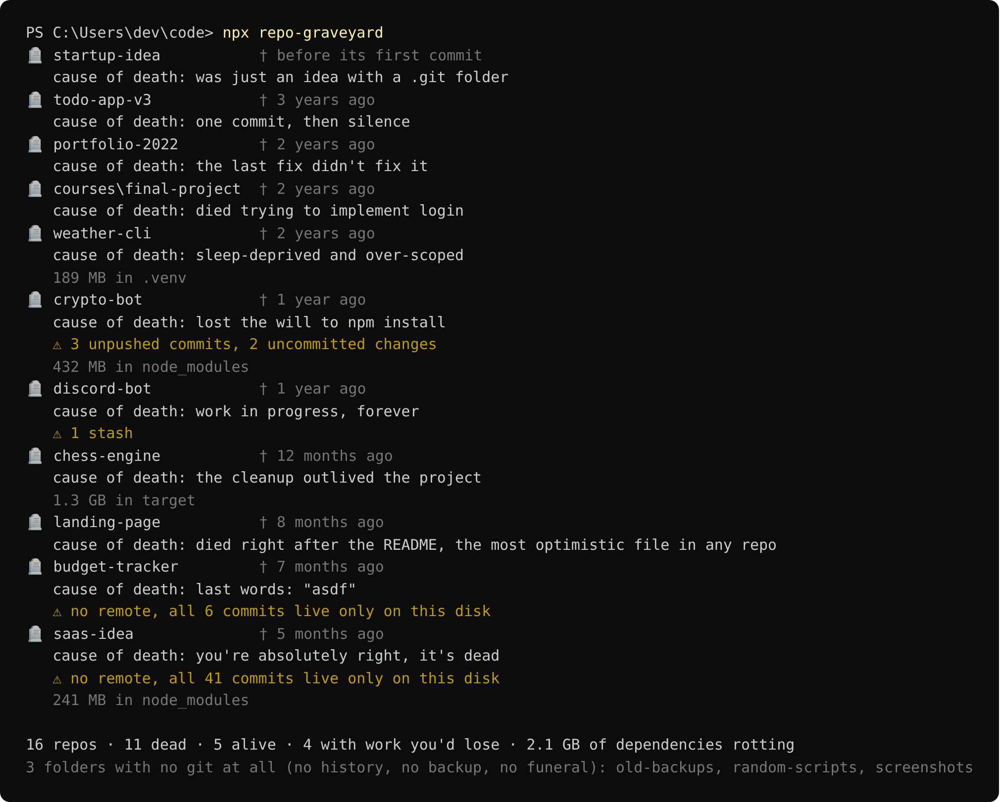

# 🪦 repo-graveyard

Every dev folder is a cemetery. This one gives each dead project a tombstone, a cause of death, and a list of the work that dies with it if your disk goes next.

```
npx repo-graveyard ~/dev
```



The jokes get you to run it. The ⚠ lines are why you keep it: commits that never left your laptop, changes you never committed, stashes you forgot about. Now that an agent can scaffold a project in one afternoon, the graveyard fills up fast.

## Usage

```
npx repo-graveyard [folder] [--days N]
```

| Option | What it does |
|---|---|
| `folder` | Where your projects live. Defaults to the current folder. Repos one level deeper count too (`dev/courses/final-project`). |
| `--days N` | Days without commits before a project is declared dead. Default: 90. |
| `-h, --help` | Shows the help. |

It only reads. Nothing gets deleted, committed or pushed. You need Node 18+ and git.

## How it decides

A repo is dead when its newest commit, on any local or remote branch, is older than `--days`. A repo with no commits was dead on arrival.

Under each tombstone:

- `⚠ N unpushed commits`: commits on local branches that no remote has.
- `⚠ no remote`: it was never pushed anywhere, so all of it lives on this disk.
- `⚠ N uncommitted changes`: modified or untracked files git doesn't have yet.
- `⚠ N stashes`: stashes never leave your machine.
- `N MB in node_modules`: also `.venv`, `venv`, `target` and `.next`. Delete them and reinstall if the project ever comes back.

The cause of death comes from evidence: the last commit message, whether a bot or a coding agent made the last commit, whether it happened at 3am, how old it is. Same repo, same verdict, every time, so your screenshots stay honest.

## Add a cause of death

They all live in [`causes.json`](causes.json). Each entry in `messages` matches a regex against the last commit message (case-insensitive) and picks one of its causes. `{msg}` gets replaced with the message itself:

```json
{
  "match": "^(asdf\\w*|stuff|changes|update)$",
  "causes": ["last words: \"{msg}\""]
}
```

The other keys (`stillborn`, `oneCommit`, `robot`, `dirty`, `night`, `ancient`, `fallback`) are plain lists of strings. Add yours, run `npm test`, open a PR. Bonus points if it happened to you.

## Run it from source

```
git clone https://github.com/NicolasPazz/repo-graveyard
cd repo-graveyard
npm test
node cli.js ~/dev
```

There are no dependencies, so there's nothing to install.

## License

[MIT](LICENSE). Rest in peace.
